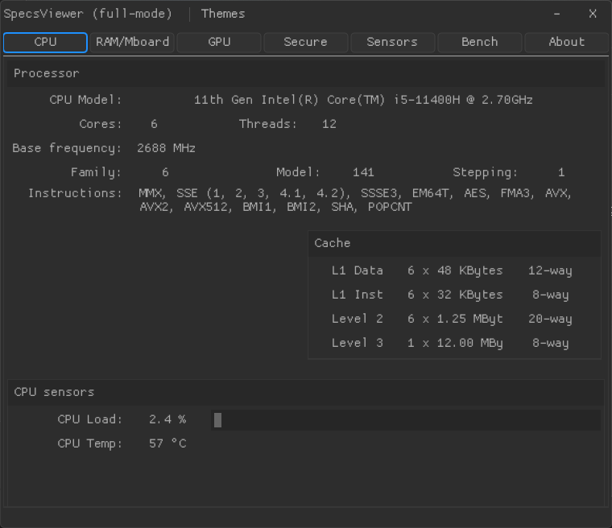
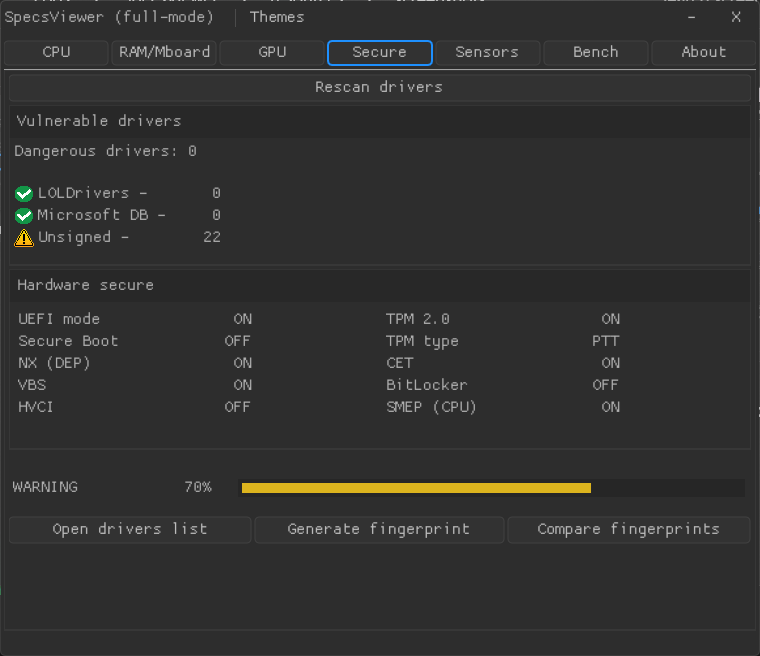
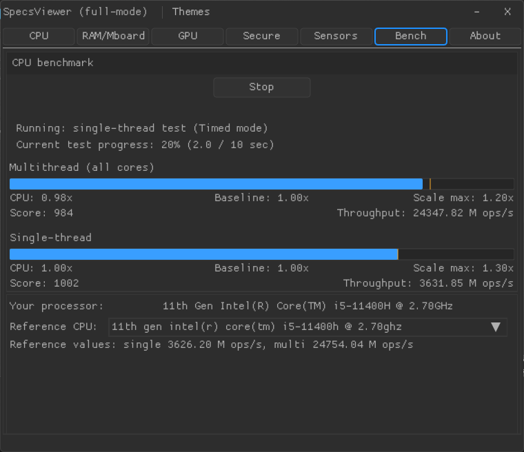

# SpecsViewer

**SpecsViewer** is a Windows desktop application for viewing detailed PC hardware information, checking platform security settings, running a basic benchmark, and generating a digital fingerprint of the system.

The program is focused not only on showing basic specifications, but also on analyzing low-level hardware and security-related data: CPU features, RAM, motherboard, GPU, BIOS/UEFI state, TPM, Secure Boot, benchmark results, and other platform characteristics.

SpecsViewer is written in **C** using the **C99** standard. The application uses **GLFW3** for window management, **Nuklear** for the graphical user interface, **GLAD** for OpenGL function loading, the **NVIDIA driver/API** for NVIDIA GPU information, and **WinRing0** for low-level hardware access.

> SpecsViewer uses **WinRing0** for low-level hardware access. It may cause antivirus warnings. I recommend adding the program folder to antivirus exclusions.

> It is also recommended to run SpecsViewer as Administrator for the most complete results. See the instruction below.

---

## Main Features

### Hardware overview

SpecsViewer collects and displays detailed information about the main PC components:

- CPU model and vendor
- CPU cores and threads
- CPU base frequency
- RAM information
- Motherboard information
- GPU information
- General system data

The goal is to provide a clear overview of the current platform without requiring the user to manually search for this information in different system tools.

---

### CPU information

The application analyzes processor data using low-level CPU instructions and system APIs.

It can show key CPU characteristics such as:

- CPU brand string
- Core and thread count
- Supported CPU features
- Architecture-related capabilities
- Base frequency and the current effective frequency
- Core VID (the core voltage requested by the CPU) read via MSR (administrator mode)
- Switching between processors on multi-socket systems (click the CPU name, marked with a dropdown arrow)

This makes the CPU section useful not only for normal specification viewing, but also for understanding what technologies are supported by the processor.

---

### RAM information

SpecsViewer provides information about installed system memory.

The RAM section is intended to quickly show the memory configuration of the machine and help identify the amount and basic characteristics of installed RAM.

The DRAM voltage configured by the firmware (SMBIOS "Configured Voltage") is shown when the BIOS reports it; on most boards this reflects the value set in BIOS or by the active XMP profile.

---

### Motherboard and BIOS/UEFI information

The program collects platform-level information related to the motherboard, firmware, and system configuration.

This is important because many security mechanisms depend not only on the operating system, but also on firmware and motherboard configuration.

---

### GPU information

SpecsViewer includes GPU detection and displays information about the graphics adapter.

At the current stage, detailed GPU information is supported only for **NVIDIA** graphics cards.

This allows the application to include GPU data in the overall hardware overview, but support for AMD and Intel graphics cards may be added later.

When several graphics adapters are present (for example an integrated GPU next to a discrete one), the active adapter can be switched by clicking the adapter name on the GPU page (it is marked with a dropdown arrow). Non-NVIDIA adapters show basic PnP and driver information.

---

### Platform security check

SpecsViewer checks important security-related mechanisms and configuration states.

The program can be used to review whether key platform protection features are enabled, disabled, or unavailable.

Examples of analyzed mechanisms:

- TPM state
- Secure Boot state
- BIOS/UEFI-related information
- Virtualization-based security (VBS, HVCI) and CPU protections (NX, SMEP, CET)
- General platform integrity indicators

The result is presented in a more understandable way than raw system data, making it easier to evaluate the current security state of the PC.

---

### Security / health score

The application calculates an overall platform score based on collected information.

This score is not meant to replace professional security auditing, but it gives the user a quick summary of the current system condition.

The score helps to quickly understand whether the system looks properly configured or if some important protection mechanisms may be missing or disabled.

---

### Benchmark

SpecsViewer includes a benchmark section for testing CPU performance.

The benchmark gives the user a quick way to estimate the current performance state of the machine and compare results after hardware, driver, or configuration changes.

The result can be useful for checking whether the system behaves normally after updates, BIOS changes, driver changes, or hardware replacement.

**How the score is built (kernel v2, since 2.2):**

- Five sub-tests with fixed working sets, each with a different performance profile: **Integer** (Murmur3-style hashing, 4 interleaved lanes), **Float** (32x32 double matrix multiply), **Memory** (random pointer chasing over 512 KB, 4 chains), **Sort** (quicksort of 2048 ints, branch-heavy) and **Scalar** (dependent sqrt / xorshift chains, pure latency).
- Each sub-test runs for an equal time slice, first on one thread (single-thread score), then on every logical processor (multithread score).
- The score is the **geometric mean** of the five sub-test rates, normalised so that the calibration CPU (Intel Core i5-11400H) gets 1000 points in single-thread. Every sub-test has the same weight, so a CPU cannot win on a single code pattern; in particular the score no longer tracks clock frequency alone.
- On hybrid CPUs the single-thread worker is kept on the fastest core class (P-cores); on systems with more than 64 logical processors the workers are spread over all processor groups.
- The same binary (SSE2 baseline) runs on every machine; no runtime CPU dispatch.
- Results are verified while the benchmark runs: every 128th kernel call of each thread starts from the same data and a fixed seed, and its output is compared with a reference. The check call does normal work and counts toward the score, so the overhead stays below the run-to-run noise. A result with calculation errors is marked invalid and cannot be submitted.

Results recorded with the previous kernel (versions before 2.2) are in different units and are not comparable; the reference list hides them.

---

### CPU stability test

The **Bench** page has a stability test under the benchmark (the page scrolls). It loads every logical processor and checks every result. It is meant for validating an overclock or undervolt: a CPU that is slightly unstable often keeps running but computes wrong values.

- One worker thread is pinned to each logical processor, so an error is attributed to a specific thread and physical core (P/E cores are marked on hybrid CPUs).
- Before the load starts, reference results are computed twice on one thread. During the test every work unit is compared with its reference; any difference is a calculation error.
- Tests: **Integer** (64/128-bit multiply, rotate, divide), **Float** (double precision chaotic map and square roots: one wrong bit changes the final result completely), **AVX2 / FMA** (256-bit FMA, the heaviest power and heat load, available when the CPU supports AVX2), **Cache / RAM** (write and verify a random pattern, 4 MB per thread) and **Mixed** (all of them in turn, so the load and power keep changing).
- Duration: presets from 5 minutes to 3 hours, **Custom** (any number of minutes) or **Unlimited** (runs until Stop, i.e. a stress test with error checking); optional stop on the first error. The settings are saved in the config.
- WHEA-Logger events from the Windows System log (hardware errors corrected by the CPU) are counted during the run and reported separately.
- The page shows CPU temperature, Core VID, frequency and load with their extremes during the run; temperature and VID need full mode (administrator).

The benchmark and the stability test cannot run at the same time.

---

### Digital fingerprint

SpecsViewer can generate a digital fingerprint of the current PC configuration.

The fingerprint is based on selected hardware and platform characteristics. It can be used to detect changes in the system configuration between different launches of the program.

This feature is useful for:

- tracking hardware changes;
- detecting unexpected platform modifications;
- comparing the current state with a previous state;
- noticing possible unauthorized or suspicious changes.

If the fingerprint does not match a previously saved state, it does not always mean that the system is compromised. It means that some part of the hardware or platform configuration has changed and should be reviewed.

---

## Screenshots

### CPU information

### Security scan

### Benchmark

---

### Autoupdate

SpecsViewer also includes an auto-updater. It can check for newer versions of the program, download the latest release, and update the application files, helping users keep SpecsViewer up to date without manually replacing files.
